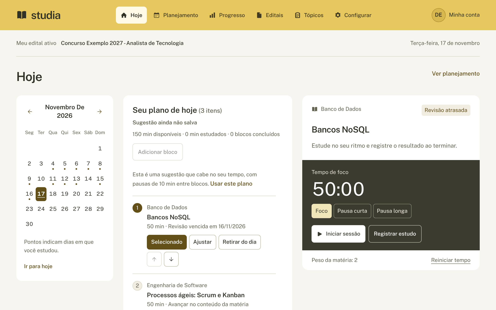
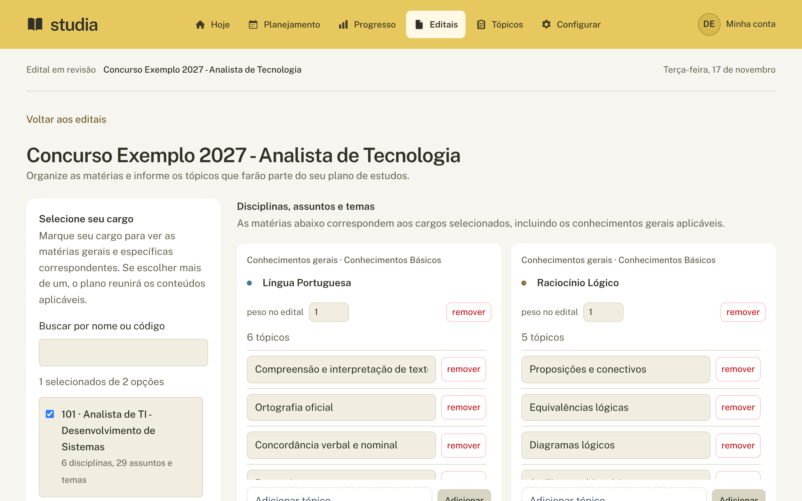
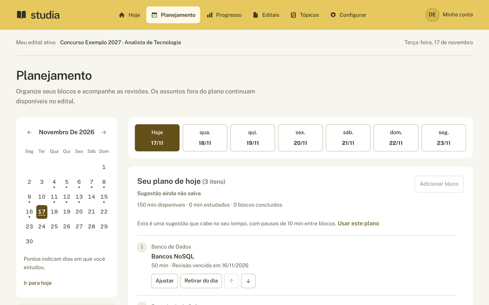

# Studia

Aplicação para organizar estudos para concursos. Você envia o PDF do edital, escolhe o cargo, a IA extrai as matérias e os tópicos daquele cargo, você confere o resultado e o sistema monta um plano diário com revisões espaçadas, ajustado pelo desempenho em questões.



## Funcionalidades

- **Importação por cargo**: o PDF é processado em segundo plano (com OCR local para páginas digitalizadas), os cargos são identificados e só o conteúdo do cargo escolhido é analisado. Trechos originais ficam lado a lado para conferência, e lacunas encontradas pedem correção antes de liberar a importação.
- **IA com alternativas**: Gemini primeiro, depois modelos gratuitos do OpenRouter. Também é possível usar a sua própria IA, copiando o prompt e colando a resposta JSON.
- **Unidades de estudo**: blocos grandes do edital são divididos em unidades menores, com recortes literais que reproduzem o texto original.
- **Plano diário**: distribui o tempo disponível entre revisões atrasadas, revisões do dia e conteúdo novo, em ordem de prioridade.
- **Revisão espaçada**: intervalos inspirados na curva de Ebbinghaus (1, 7, 16, 35 e 90 dias) que avançam ou recuam conforme os acertos.
- **Contas administradas**: sem cadastro aberto; administradores criam contas com senha temporária e troca obrigatória no primeiro acesso.
- Pomodoro, metas semanais e histórico de sessões.

| Edital por cargo | Planejamento |
| --- | --- |
|  |  |

A regra de negócio original está em [docs/planejamento.md](docs/planejamento.md). Decisões técnicas ficam em [docs/adr](docs/adr) e [docs/decisions](docs/decisions), e as análises de cada etapa, em [docs/analises](docs/analises).

## Tecnologias

- Frontend: React, TypeScript, Vite e Tailwind CSS
- API: PHP com CodeIgniter 4 e Shield (autenticação)
- Banco e fila de processamento: PostgreSQL
- IA: Google Gemini e OpenRouter; OCR local para PDFs digitalizados
- Infra: Docker Compose (Nginx, PHP-FPM, worker e PostgreSQL)

## Requisitos

- Docker Desktop com Docker Compose
- Portas `8088` e `5433` livres, ou outras definidas no `.env`

## Início rápido

No PowerShell:

```powershell
.\scripts\start.ps1
```

No Linux ou macOS:

```sh
sh scripts/start.sh
```

Na primeira execução, o script copia `.env.example` para `.env`. A aplicação fica disponível em <http://localhost:8088>. O PostgreSQL fica acessível no computador pela porta `5433` e, entre os contêineres, pelo endereço `postgres:5432`.

Para analisar editais com IA, preencha `GEMINI_API` e/ou `OPENROUTER_API_KEY` no `.env`. O arquivo é ignorado pelo Git e não deve ser versionado. Quando `GEMINI_API` estiver preenchida, o Gemini é a primeira tentativa. Se falhar, a importação consulta o catálogo do OpenRouter e tenta modelos gratuitos compatíveis até obter uma resposta aprovada pela validação ou atingir os limites.

`GEMINI_MODEL` escolhe o modelo direto do Google (padrão: `gemini-3.6-flash`, com nível gratuito). A disponibilidade e as cotas dependem do projeto no Google AI Studio. A API direta não oferece o filtro de preço máximo zero do OpenRouter; uma chave de projeto com cobrança ativa segue a tabela de preços do Google. A aplicação não habilita cobrança nem muda o plano da conta.

### Limites de importação com IA

```dotenv
OPENROUTER_TOTAL_TIMEOUT_SECONDS=300
OPENROUTER_ATTEMPT_TIMEOUT_SECONDS=90
OPENROUTER_MAX_ATTEMPTS=4
OPENROUTER_FALLBACK_MODELS=
```

`OPENROUTER_MODEL` é a primeira preferência dentro do OpenRouter, se estiver disponível, gratuito e compatível com o documento. `OPENROUTER_FALLBACK_MODELS` aceita outros IDs separados por vírgula; depois dessas preferências, o sistema usa o catálogo atual. Modelos pagos do OpenRouter são excluídos mesmo quando configurados. Os limites acima são compartilhados pelos dois provedores: o Gemini consome uma tentativa, e o prazo não reinicia ao passar para o OpenRouter. O prazo total inclui a consulta ao catálogo, esperas, chamadas e validação, e tem teto de 540 segundos para respeitar o tempo do servidor web. O timeout de cada chamada nunca ultrapassa o prazo restante.

`OPENROUTER_MAX_TOKENS` limita a resposta, respeitando também o contexto e o limite de saída de cada modelo. Nenhum texto do edital é cortado para caber. Se nenhum modelo for elegível, a importação explica o motivo. Problemas com a chave e cotas sem previsão de liberação dentro do prazo encerram as tentativas. Uma espera indicada pelo provedor só é aceita se couber no prazo restante e não ultrapassar 30 segundos; trocar de modelo não contorna a cota gratuita da conta.

A aprovação verifica a estrutura e sinais de incompletude, mas não garante a fidelidade integral ao PDF. Revise o resultado antes de ativar o edital. As tentativas ficam registradas em `extraction_runs`, com modelo, duração e motivo da falha.

Editais exclusivamente de títulos ou experiência profissional podem não ter conteúdo programático de prova. Nesse caso, uma análise completa salva o nome e informa a ausência de matérias, sem criar um plano de estudos artificial. O exemplo `exemplos_editais/edital4.pdf` é desse tipo.

O teste real opcional `node prototypes/edital4/import-api.mjs` envia esse PDF pela API, verifica o resultado e remove a conta de teste. Ele exige os contêineres ativos e consome a cota gratuita da chave configurada.

Após alterar essas variáveis, aplique-as com `docker compose up -d --no-deps php`. Os padrões já funcionam sem acrescentá-las ao `.env` existente.

O contêiner instala as dependências PHP e executa as migrações ao iniciar. Se `APP_ENCRYPTION_KEY` estiver vazio, ele cria uma chave temporária. Para manter sessões e dados criptografados válidos após reinicializações, defina uma chave permanente no `.env`, por exemplo com `php -r "echo 'hex2bin:'.bin2hex(random_bytes(32));"`.

## Portas

As portas expostas são configuradas no `.env`:

```dotenv
APP_PORT=8088
POSTGRES_PORT=5433
APP_BASE_URL=http://localhost:8088
```

Quando a porta `8080` estiver livre, altere `APP_PORT` e `APP_BASE_URL` e recrie os contêineres:

```powershell
docker compose up -d --force-recreate
```

## Acesso público pelo Tailscale (opcional)

O arquivo `compose.tailscale.yaml` adiciona um contêiner Tailscale que publica o app com Funnel, em um endereço HTTPS sem precisar instalar o Tailscale em quem acessa. A autenticação fica persistida em um volume Docker, sem chaves no repositório.

```powershell
docker compose -f compose.yaml -f compose.tailscale.yaml up -d
```

Ao recriar o serviço `web`, recrie também `tailscale`, pois eles compartilham a
rede. Para configurar uma instalação nova, consulte
[a decisão sobre o acesso público](docs/adr/0002-tailscale-publico.md).

## Comandos úteis

### Administração de contas

O cadastro público está desabilitado. Administradores encontram a opção
**Usuários** no menu para criar uma conta informando o e-mail. O servidor gera
uma senha temporária e uma mensagem para copiar e enviar à pessoa. Essa senha
aparece apenas na criação, sem ser guardada em texto no banco ou na interface.
O primeiro acesso exige trocar a senha antes de usar as demais funções.

Para promover uma conta existente pelo terminal, use o comando do Shield:

```powershell
docker compose exec php php spark shield:user addgroup -e EMAIL_DA_CONTA -g admin
```

O teste HTTP `server/tests/api/admin-users.mjs` usa uma conta administrativa
temporária criada por `php tests/api/admin-users-fixture.php setup` no serviço
PHP. Ele verifica permissões, CSRF, convites, troca obrigatória e login com a
nova senha. Ao terminar, execute `php tests/api/admin-users-fixture.php cleanup`
no mesmo serviço, inclusive se o teste falhar. A fixture fica em
`server/writable/testing/`, ignorada pelo Git. O teste de navegador correspondente
é `server/tests/api/admin-users-browser.mjs` e usa um navegador isolado com CDP.

```powershell
# Estado dos serviços
docker compose ps

# Logs
docker compose logs -f

# Testes do backend
docker compose exec php composer test

# Migrações
docker compose exec php php spark migrate

# Encerrar sem apagar o banco
.\scripts\stop.ps1
```

Para também remover os dados locais do PostgreSQL, execute `docker compose down --volumes`. Esse comando apaga o banco deste projeto.

## Estrutura

### Importar um edital por cargo

Em **Editais > Novo edital**, envie o PDF, identifique os cargos e escolha o
nome e código que deseja estudar. Depois, analise apenas o conteúdo aplicável,
confira os trechos originais e confirme a importação. A seleção e o rascunho
podem ser retomados pela lista de editais.

Com Gemini ou OpenRouter configurados, as duas análises podem ser feitas no
sistema. A opção de usar sua própria IA gera um prompt por etapa e recebe o
JSON correspondente. Falhas da API não removem o rascunho. A importação de JSON
completo continua em **Já tenho uma resposta JSON completa**.

Confira as páginas e o final dos conteúdos gerais e específicos antes de
importar. A IA pode omitir trechos, mesmo quando a resposta passa na validação.
Após importar, **Organizar estudos** permite dividir os blocos em unidades menores.
Se aparecerem trechos pendentes, use **Corrigir trechos pendentes**. O sistema
preserva os blocos encontrados e confere novamente antes de liberar a importação.
Quando um trecho pertencer a outro cargo, registre a decisão e o motivo na revisão.
O andamento das próximas etapas está no [plano do PDF aos estudos](docs/analises/2026-10-18-plano-pdf-para-estudos.md).
O upload principal processa o arquivo em segundo plano pelo serviço `worker`.
Páginas digitalizadas passam por OCR local em português e inglês. É possível
cancelar e retomar; as páginas reconhecidas ficam em cache. Os limites são
15 MB, 200 páginas, dez minutos por rodada de leitura e prazo por página.
Resultados reconhecidos de imagens precisam de conferência no PDF original.
Retificações e documentos sem programa claramente identificado pedem confirmação
do conjunto de arquivos. As unidades são divididas localmente com recortes
literais, e sua concatenação precisa reproduzir a fonte completa.

Ao atualizar uma instalação existente, reconstrua `php` e inicie também `worker`.
Para consultar a fila: `docker compose logs --tail 50 worker`. A fila reside no
PostgreSQL e preserva trabalhos interrompidos para retomada explícita. O comando
`php spark imports:work --once` processa no máximo um trabalho para diagnóstico.
Detalhes e resultados: [teste da importação por cargo](docs/analises/2026-10-18-importacao-por-cargo.md).

O layout Mesa de estudo usa os tokens semânticos de `app/src/index.css` e os
componentes visuais de `app/src/styles/mesa.css`. A decisão e o escopo estão em
[0004-layout-mesa-de-estudo.md](docs/adr/0004-layout-mesa-de-estudo.md).

- `app/`: frontend React e Vite
- `server/`: API CodeIgniter 4 e Shield
- `docker/`: imagens e configuração dos serviços
- `docs/adr/`: decisões arquiteturais
- `scripts/`: comandos curtos de inicialização e encerramento

O Nginx entrega o frontend e encaminha requisições iniciadas por `/api` para o CodeIgniter.

## Licença

[MIT](LICENSE)
